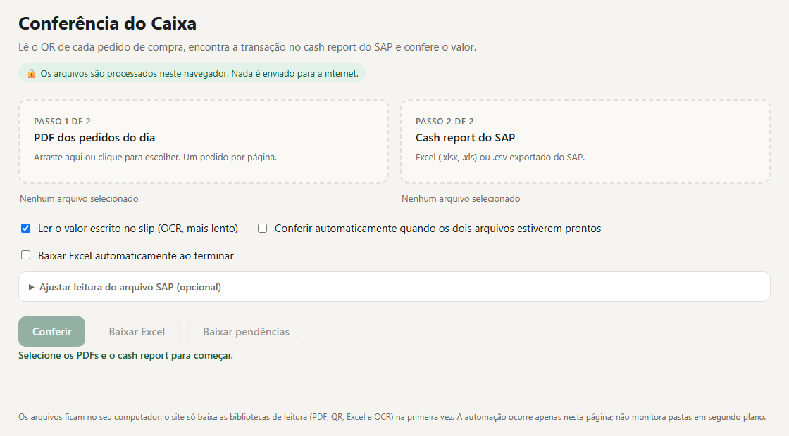

# Conferência do Caixa

Ferramenta que roda no navegador para conciliar pedidos de compra com o cash report do SAP. Ela lê o QR code de cada pedido em PDF, encontra a transação correspondente no relatório e confere se o valor bate.

## O problema

No fechamento do dia, alguém precisa abrir cada pedido, achar a transação no relatório do SAP e comparar o valor, linha por linha. Com dezenas de pedidos, isso leva tempo e é fácil deixar passar uma diferença ou uma transação repetida.

## Como funciona

1. **PDF dos pedidos do dia:** um pedido por página.
2. **Cash report do SAP:** Excel (`.xlsx`, `.xls`) ou `.csv`.
3. A ferramenta lê o QR code de cada página e localiza a transação no cash report. Se a opção estiver ligada, também lê o valor escrito no slip com OCR.
4. Compara o valor do pedido com o do caixa, dentro de uma tolerância que você define.
5. Mostra o resultado por pedido e gera um Excel com a conciliação e outro só com as pendências.

As colunas do relatório do SAP são identificadas sozinhas. Se o layout for diferente, dá para informar o nome da coluna de transação, valor e código.

## O que aparece no resultado

| Status | Significado |
|---|---|
| Conferido | Transação encontrada e valor dentro da tolerância |
| Valor divergente | Transação encontrada, mas o valor não bate |
| Encontrado, valor não conferido | Transação encontrada, sem valor no caixa ou no slip para comparar |
| QR não encontrado no cash report | O código do pedido não existe no relatório |
| QR ilegível | O QR da página não pôde ser lido |
| Transação repetida | A mesma transação aparece em mais de uma página |

## Privacidade

Os arquivos são processados no próprio navegador. Nada é enviado para a internet: a página só baixa as bibliotecas de leitura (PDF, QR, Excel e OCR) na primeira vez.

## Tecnologias

- HTML, CSS e JavaScript, em um único arquivo
- [PDF.js](https://mozilla.github.io/pdf.js/) para ler os PDFs
- [zxing-wasm](https://github.com/Sec-ant/zxing-wasm) para ler os QR codes
- [Tesseract.js](https://tesseract.projectnaptha.com/) para o OCR do valor no slip
- [SheetJS](https://sheetjs.com/) e [ExcelJS](https://github.com/exceljs/exceljs) para ler o relatório e gerar o Excel

## Como usar

Baixe o `index.html` e abra no navegador. Não precisa instalar nada.

---

Feito por [Alexandre Wang](https://alexandrewang.vercel.app), Supply Chain Analytics e Automação.
